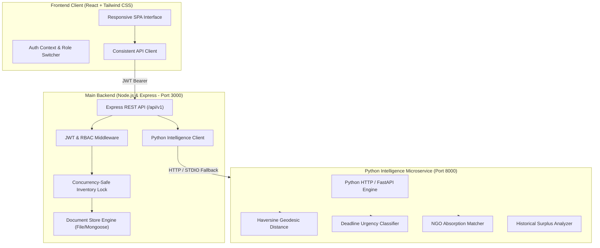

# SharePlate — Smart Food Redistribution Platform

> A production-minded full-stack platform connecting restaurants, college hostels, hotels, caterers, verified NGOs, and volunteers to redistribute wholesome surplus food safely, rapidly, and transparently.

---

## 1. Real-World Problem & Objective

Over one-third of all edible food produced globally is discarded, generating significant greenhouse gas emissions, while charitable kitchens and shelters struggle daily with food insecurity.

**SharePlate is NOT a food ordering platform.** Food is donated without customer checkout, shopping carts, or paid food delivery workflows. The platform provides:
1. **Expiry-Aware Intake**: Food donors specify preparation timestamps, storage temperature categories (refrigerated, heated, dry), allergen declarations, and strict pickup deadlines.
2. **Rule-Based Algorithmic Recipient Matching**: A dedicated Python intelligence engine ranks nearby verified non-profits considering geodesic Haversine distance, daily meal absorption capacity, accepted food categories, and remaining shelf life.
3. **Cryptographically Verified Handovers**: Couriers and NGOs complete physical transfers via single-use, time-limited QR codes and alphanumeric verification tokens.
4. **Transparent Impact Accounting**: Real-time environmental metrics (avoided CO₂e emissions based on EPA WARM and FAO benchmarks) derived from verified handovers.

---

## 2. Architecture Diagram



---

## 3. Technology Stack

- **Frontend**: React 19, TypeScript, Tailwind CSS v4, Lucide React, Recharts, QR Code generator.
- **Main Backend**: Node.js v22, Express.js, TypeScript (`tsx`), JWT authentication, bcryptjs, cookie-parser, CORS, centralized error handling.
- **Python Intelligence Service**: Python 3.10 microservice, Haversine spherical distance math, urgency scoring state machine, surplus trend aggregation.
- **Testing**: Node.js built-in test runner (`test/backend.test.js`) and Python `unittest` test suite (`intelligence/test_matching.py`).
- **Containerization**: Multi-stage `docker-compose.yml`, `Dockerfile.backend`, `Dockerfile.intelligence`.

---

## 4. User Roles & Workflows

| Role | Key Capabilities | Default Demo Account |
| :--- | :--- | :--- |
| **Provider** | Publish surplus listings, review inbound claims, approve/reject requests with atomic reservation, present QR/handover code. | `baker@greenharvest.com` / `SharePlate@2026` |
| **NGO Recipient** | Search available meals, inspect dietary tags and distance, receive algorithmic match scores, request portions, track delivery. | `director@hopekitchen.org` / `SharePlate@2026` |
| **Volunteer Courier** | Accept pickup routes, navigate to kitchen dock, verify physical handover via 6-character code / QR scan, deliver to NGO hub. | `volunteer@shareplate.org` / `SharePlate@2026` |
| **Administrator** | Review pending 501(c)(3) and charity licenses, investigate food hygiene reports, audit administrative action logs. | `admin@shareplate.org` / `Admin@1234` |

*Tip: A one-click demo switcher is pinned at the top of the interface for instant testing across all 4 roles.*

---

## 5. REST API Endpoint Reference

All main API endpoints are prefixed with `/api/v1`:

### Authentication & Profiles
- `POST /api/v1/auth/register` — Register provider, NGO, or volunteer (admin disallowed publicly).
- `POST /api/v1/auth/login` — Sign in with email and password, returns JWT token.
- `POST /api/v1/auth/demo-login` — Fast-switch into one of the 4 demo accounts.
- `GET /api/v1/auth/me` — Retrieve active authenticated user profile.
- `POST /api/v1/auth/logout` — Clear session cookies.

### Surplus Food Listings
- `GET /api/v1/listings` — List available surplus batches with category, dietary, search, and urgency filters.
- `GET /api/v1/listings/:id` — Detail view with real-time urgency and allergen notes.
- `POST /api/v1/listings` — Publish new food listing (verified provider/admin only).
- `PUT /api/v1/listings/:id` — Update listing before reservation.
- `DELETE /api/v1/listings/:id` — Cancel listing and release any associated reservations.

### Requests & Concurrency-Safe Approvals
- `POST /api/v1/requests` — Submit portion request ($\le$ available inventory).
- `GET /api/v1/requests` — View filtered requests by role.
- `PUT /api/v1/requests/:id/approve` — Atomic check-and-reserve inventory; generates pickup task.
- `PUT /api/v1/requests/:id/reject` — Decline request with reason.
- `PUT /api/v1/requests/:id/cancel` — Cancel claim and release reserved stock.

### Pickups & QR Verification
- `GET /api/v1/pickups` — View assigned pickups and claimable tasks.
- `POST /api/v1/pickups/:id/assign` — Claim task as volunteer.
- `GET /api/v1/pickups/:id/qr` — Generate dynamic QR code data URL and verification secret.
- `POST /api/v1/pickups/:id/verify-code` — Verify SHA-256 hash match to confirm pickup or delivery.
- `PUT /api/v1/pickups/:id/status` — Advance state (`assigned` $\rightarrow$ `accepted`).

### Python Intelligence Microservice
- `GET /api/v1/intelligence/health` — Microservice health status.
- `POST /api/v1/intelligence/recommend-recipients` — Run rule-based matching for a listing.
- `GET /api/v1/intelligence/urgency/:listingId` — Deadline urgency scoring.
- `GET /api/v1/intelligence/surplus-summary` — Aggregated surplus trends.

### Administration & Safety
- `GET /api/v1/verifications` — List organization verification applications.
- `PUT /api/v1/verifications/:id/review` — Approve or reject NGO/provider.
- `POST /api/v1/safety-reports` — File food safety or hygiene report.
- `GET /api/v1/safety-reports` — View reported concerns (admin only).
- `PUT /api/v1/safety-reports/:id/resolve` — Mark concern resolved.
- `GET /api/v1/audit-logs` — Administrative audit log list.

---

## 6. Running the Application Locally

### Prerequisites
- Node.js $\ge 18$
- Python $\ge 3.10$

### Setup & Run
```bash
# 1. Install dependencies
npm install

# 2. Run backend and frontend together on port 3000
npm run dev
```

The Express server automatically starts the Python intelligence microservice on port 8000 and mounts the Vite frontend SPA on port 3000.

### Running with Docker Compose
```bash
docker compose up --build
```

---

## 7. Automated Testing

### Backend & Business Logic Tests
```bash
npm test
```
Executes Node.js integration tests covering:
- Cryptographic SHA-256 pickup verification hashing
- Quantity boundary validation ($\text{requested} \le \text{remaining}$)
- Atomic inventory reservation concurrency safety
- Deadline expiry detection
- Strict pickup state machine transitions

### Python Matching Engine Tests
```bash
python3 -m unittest intelligence/test_matching.py
```
Executes Python unit tests covering:
- Haversine geodesic distance calculation
- Urgency scoring priority boundaries (Critical, High, Moderate, Low, Expired)
- Multi-factor NGO recipient matching and ranking
- Historical surplus analytics aggregation

---

## 8. Food Safety Compliance Notice

SharePlate is designed in alignment with the **Bill Emerson Good Samaritan Food Donation Act**. Food donors and recipient non-profits are legally protected when donating wholesome food in good faith. All donors on SharePlate must declare temperature controls, hygiene precautions, and allergen disclosures before listings are published.
